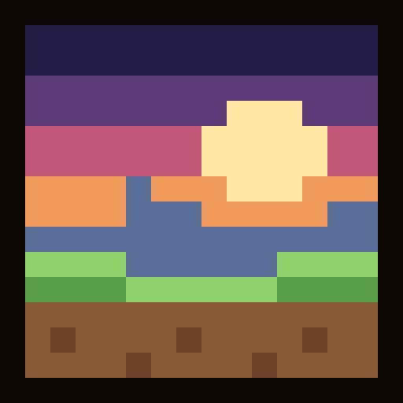
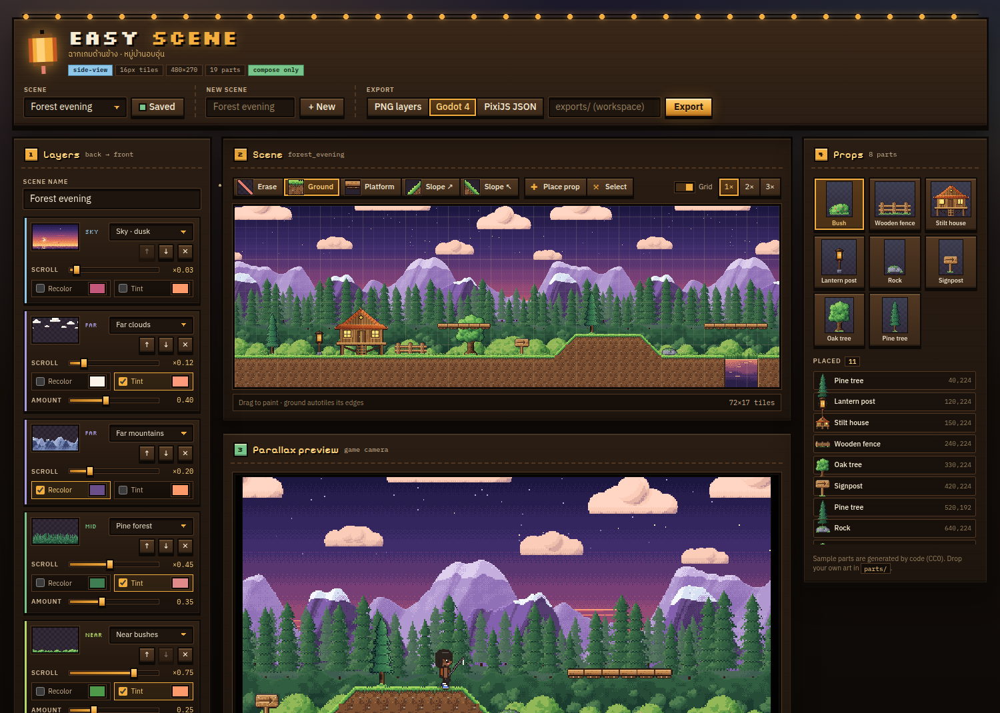
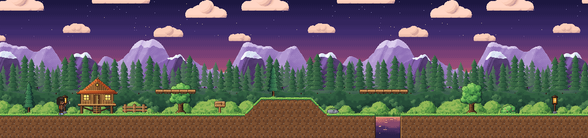
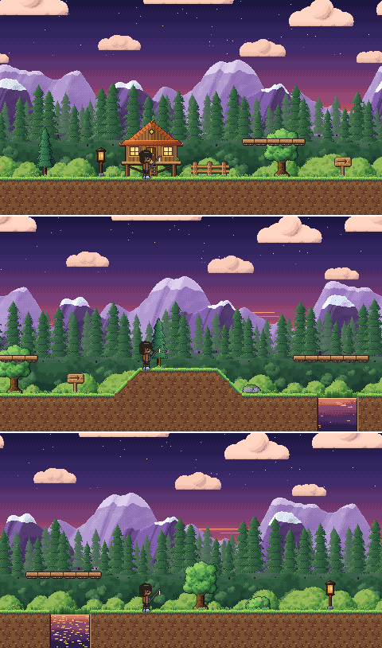
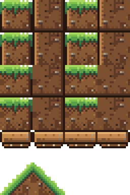
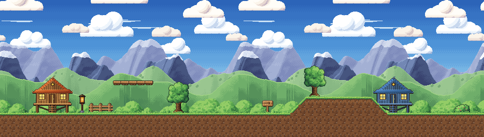
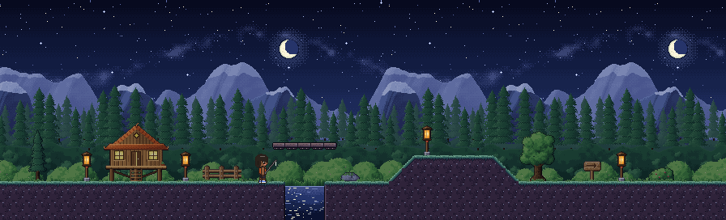

<p align="center">
  
</p>

# Easy Scene

**ฉากเกมด้านข้าง · หมู่บ้านอบอุ่น**  
Compose **side-view** 2D game scenes from modular parts — parallax backgrounds, **16px** autotiles, props — and export them to **Godot 4**, **PixiJS** or plain PNG. The sibling of [Easy Sprite](https://github.com/Saladin2020/easysprite): its 48px side-view characters walk straight into these scenes.

[](https://github.com/Saladin2020/easyscene/actions/workflows/ci.yml)
[](LICENSE)
[](https://nodejs.org)
[](#export)
[](docs/MCP.md)

> You prep the art. Easy Scene only **selects · arranges · recolors · previews · exports**.  
> No AI art generation in-app.

<p align="center">
  
</p>

<p align="center">
  
</p>

---

## Why it exists

Build a whole side-scroller level without hand-placing every layer: stack 3–5 parallax layers, paint ground with tiles that fix their own edges, drop in houses and trees, and get a Godot scene that already scrolls and collides.

| Parallax | Tiles | Props |
| --- | --- | --- |
| sky (day · dusk · night) · far clouds / mountains · mid hills / forest · near bushes, each with its own scroll factor, seamless loop, recolor / tint | ground (16-variant autotile) · one-way platforms · 45° slopes, in grass · grass-night · stone | oak · pine · stilt house · fence · sign · rock · bush · lantern |

<p align="center">
  
  
</p>

<p align="center">
  
</p>

<p align="center">
  
</p>

The samples share one light direction (top-left), hue-shifted ramps and dithered atmospheric haze on far layers, so you can mix any sky with any layer. Three themes ship as demo scenes: `village_day`, `forest_evening` and `lantern_night` (`bg_sky_night` + `tiles_grass_night`, with props tinted blue and lanterns left glowing).

---

## Quick start

```bash
git clone https://github.com/Saladin2020/easyscene.git
cd easyscene
npm install
npm run init          # sample parts + demo scenes (first run)
npm run build
npm run desktop       # open the editor in your browser (http://127.0.0.1:8788)
```

Dev mode (API + Vite):

```bash
npm run dev
# API  http://127.0.0.1:8788
# UI   http://127.0.0.1:5174
```

---

## CLI

```bash
npx tsx src/cli.ts info
npx tsx src/cli.ts parts --kind background
npx tsx src/cli.ts compose --id forest_evening --name "Forest evening" --width 72 \
  --layers bg_sky_dusk,bg_far_clouds,bg_far_mountains,bg_mid_forest,bg_near_bushes \
  --color bg_far_mountains=#6a4f8a --tint bg_far_clouds=#ff9a7a@0.4 \
  --tint bg_mid_forest=#e08a8a@0.35 --tint bg_near_bushes=#ff9a6a@0.25 \
  --ground 3 --hill 30,6,2 --pit 46,3 --platform 19,3,5 --platform 44,3,6 \
  --prop prop_house@150 --prop prop_tree_pine@520,flip --prop prop_bush@980,front \
  --character ../easysprite/exports/walker_side.png \
  --export all --out ./my-exports
npx tsx src/cli.ts export --id forest_evening --preset godot --out ./my-exports
npx tsx src/cli.ts render --id forest_evening --mode parallax --out parallax.png
```

`compose` (alias `new`) also takes `--tiles-file rows.txt` for hand-drawn grids or `--input scene.json` for a full recipe. Folders you pass to `--out` / `--scenes-dir` are allowed for that run.

---

## Export

| Preset | You get |
| --- | --- |
| `png` | one PNG per parallax layer (recolored), `tilemap.png`, `props_back/front.png`, combined `*_preview.png`, `*_parallax.png` strip, scene JSON |
| `godot` | self-contained **Godot 4.3+** project folder: `<id>.tscn` with `Parallax2D` layers (`scroll_scale`, `repeat_size`), `TileMapLayer` + `<id>_tileset.tres` (physics polygons, one-way platforms), back/front props, extra `StaticBody2D` boxes, `Camera2D` with an arrow-key pan script, `project.godot` with Nearest filtering. `--godot-parallax legacy` emits `ParallaxBackground` / `ParallaxLayer` instead. |
| `pixi` | layer PNGs + tileset + props + `<id>.pixi.json` (scroll factors, loop widths, tile indices, merged collision rects, slopes) + a small `load-scene.js` for **PixiJS v8** |

Everything is nearest-neighbour. Scene JSON: [`docs/SCENE_FORMAT.md`](docs/SCENE_FORMAT.md).

### Easy Sprite characters

Point the preview at any Easy Sprite **side-view** native sheet (1440×144 · rows `right left front` · 48px frames). The editor's parallax preview walks it across the level (`walk0–2`), and PNG previews draw it standing on the ground. Paths must be inside the workspace or `EASYSCENE_ALLOWED_DIRS`.

---

## Features

- Parallax builder: up to 5 layers, per-layer scroll factor, seamless horizontal looping, hue recolor (same algorithm as Easy Sprite) and multiply tint
- 16px side-view tiles: edge-aware autotile, one-way platforms with end caps, slopes, terrain builder (`groundHeight`, `hills`, `pits`, `platforms`)
- Editor: paint tiles on a grid, place / drag / flip / recolor props, live game-camera preview with play / scrub / speed
- Collision from tiles + prop boxes + hand-drawn rects
- **MCP** tools for agents — compose and export without clicking ([docs/MCP.md](docs/MCP.md))
- Local-only API (same guard as Easy Sprite), PWA icons and manifest

---

## Commands

```bash
npm run init
npm run serve            # http://127.0.0.1:8788
npm run desktop
npm run build
npm run mcp              # stdio MCP
npm run mcp:http         # http://127.0.0.1:8796/mcp  (any port: -- --port 18796)
npm run typecheck
npm test                 # vitest unit tests
npm run smoke            # MCP + CLI smoke tests (run npm run init first)
npm run icons            # re-bake favicon / PWA icons
npm run capture:ui       # headless Chrome screenshot of the running UI
npm run docs:images      # re-render the README art in docs/assets (-- --character sheet.png)
```

### Security

Same rules as Easy Sprite: no CORS; loopback `Host` only on `127.0.0.1`; a token for any other host (`EASYSCENE_TOKEN`); scenes, exports and character sheets only inside the workspace or `EASYSCENE_ALLOWED_DIRS`; scene ids limited to `a-z 0-9 _ -`.

---

## License / credit

Easy Scene's code is released under the [MIT License](LICENSE) © 2026 Salahuddin Benno.

The sample parts are **original art generated by code** (`src/lib/sampleParts.ts`, seeded noise + shapes) — no third-party pixels — and are dedicated to the public domain (**CC0-1.0**). `npm run init` writes them with a `parts/CREDITS.md` manifest; every sample `part.json` carries `"sample": true`. Replace them with your own Aseprite art any time.

> หมายเหตุ: ตอนนี้ไฟล์ `.tscn` สร้างตามรูปแบบของ Godot 4.3 แต่ยังไม่เคยเปิดทดสอบใน Godot จริง ถ้าเจอปัญหาตอนนำเข้า ฝากเปิด issue ไว้ได้เลยครับ

---

<p align="center">
  <sub>teak · lanterns · parallax dreams</sub>
</p>
