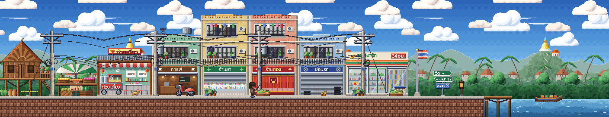
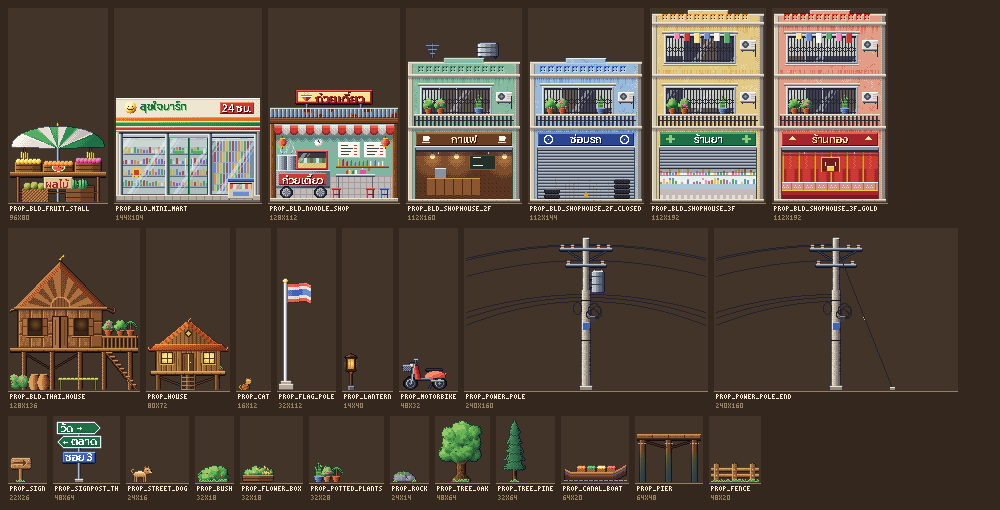
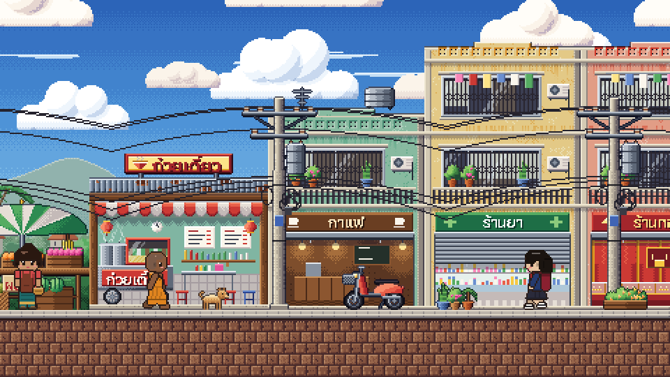

<p align="center">
  
</p>

# Easy Scene

**ฉากเกมด้านข้าง · หมู่บ้านอบอุ่น**  
Compose **side-view** 2D game scenes from modular parts — parallax backgrounds, **16px** autotiles, props — and export them to **Godot 4**, **PixiJS** or plain PNG. The sibling of [Easy Sprite](https://github.com/Saladin2020/easysprite): its 48px side-view characters walk straight into these scenes.

[](https://github.com/Saladin2020/easyscene/actions/workflows/ci.yml)
[](LICENSE)
[](https://nodejs.org)
[](#export)
[](docs/MCP.md)

> You prep the art. Easy Scene only **selects · arranges · recolors · previews · exports**.  
> No AI art generation in-app.

<p align="center">
  
</p>

<p align="center">
  
</p>

---

## Why it exists

Build a whole side-scroller level without hand-placing every layer: stack 3–5 parallax layers, paint ground with tiles that fix their own edges, drop in houses and trees, and get a Godot scene that already scrolls and collides.

| Parallax | Tiles | Props |
| --- | --- | --- |
| sky (day · dusk · night) · far clouds / mountains / temple hill · mid hills / forest / tropical town · near bushes, each with its own scroll factor, seamless loop, recolor / tint | ground (16-variant autotile) · one-way platforms · 45° slopes, in grass · grass-night · stone · sidewalk + laterite | grouped by category: **buildings** (Thai town set + stilt house) · **street** (power poles, flag pole, signposts, motorbike, dog, cat, lantern) · **nature** · **water** (pier, canal boat) · **decor** |

<p align="center">
  
  
</p>

<p align="center">
  
</p>

<p align="center">
  
</p>

### Thai town street

Modular Thai-style buildings that chain into a town: noodle shop, mini mart (generic striped fascia, no brand), fruit stall, 2–3 floor shophouses (café, garage, pharmacy, gold shop) and a teak stilt house, plus power poles whose wires join pole to pole, a Thai flag pole, a Thai signpost, potted plants, flower boxes, a motorbike, a dog and a cat, a canal pier and a long-tail boat. The demo scene `thai_village_street` puts them in a row on the new `tiles_street` sidewalk, with `bg_far_temple_hill` and `bg_mid_tropical` behind and a canal at the end.

<p align="center">
  
</p>

<p align="center">
  
</p>

Building rules (any `category: "building"` prop, yours too): width is a multiple of 16, the art reaches both edges of its footprint and the bottom row is the ground line. So a row chains with `x += width`; `streets` in a compose recipe does it for you (`--street 0:prop_bld_thai_house,prop_bld_noodle_shop,…` on the CLI), and in the editor a dragged building snaps to its neighbour's edge (Shift places freely). Thai sign text is pre-rasterized from **Kanit** (SIL OFL 1.1) by `scripts/gen-thai-signs.py`, so no font ships at runtime. `npx tsx scripts/render-catalog.ts <outDir>` renders the street, 3× crops and this catalog.

The samples share one light direction (top-left), hue-shifted ramps and dithered atmospheric haze on far layers, so you can mix any sky with any layer. Four themes ship as demo scenes: `village_day`, `forest_evening`, `lantern_night` and `thai_village_street` (`bg_sky_night` + `tiles_grass_night`, with props tinted blue and lanterns left glowing).

---

## Quick start

```bash
git clone https://github.com/Saladin2020/easyscene.git
cd easyscene
npm install
npm run init          # sample parts + demo scenes (first run)
npm run build
npm run desktop       # open the editor in your browser (http://127.0.0.1:8788)
```

Dev mode (API + Vite):

```bash
npm run dev
# API  http://127.0.0.1:8788
# UI   http://127.0.0.1:5174
```

---

## CLI

```bash
npx tsx src/cli.ts info
npx tsx src/cli.ts parts --kind background
npx tsx src/cli.ts parts --category building
npx tsx src/cli.ts compose --id forest_evening --name "Forest evening" --width 72 \
  --layers bg_sky_dusk,bg_far_clouds,bg_far_mountains,bg_mid_forest,bg_near_bushes \
  --color bg_far_mountains=#6a4f8a --tint bg_far_clouds=#ff9a7a@0.4 \
  --tint bg_mid_forest=#e08a8a@0.35 --tint bg_near_bushes=#ff9a6a@0.25 \
  --ground 3 --hill 30,6,2 --pit 46,3 --platform 19,3,5 --platform 44,3,6 \
  --prop prop_house@150 --prop prop_tree_pine@520,flip --prop prop_bush@980,front \
  --street 1200:prop_bld_noodle_shop,prop_bld_shophouse_2f \
  --character ../easysprite/exports/walker_side.png:96:right:walk \
  --character ../easysprite/exports/auntie_side.png:540:front \
  --export all --out ./my-exports
npx tsx src/cli.ts export --id forest_evening --preset godot --out ./my-exports
npx tsx src/cli.ts render --id forest_evening --mode parallax --out parallax.png
```

`compose` (alias `new`) also takes `--tiles-file rows.txt` for hand-drawn grids or `--input scene.json` for a full recipe. Folders you pass to `--out` / `--scenes-dir` are allowed for that run.

---

## Export

| Preset | You get |
| --- | --- |
| `png` | one PNG per parallax layer (recolored), `tilemap.png`, `props_back/front.png`, combined `*_preview.png`, `*_parallax.png` strip, scene JSON |
| `godot` | self-contained **Godot 4.3+** project folder: `<id>.tscn` with `Parallax2D` layers (`scroll_scale`, `repeat_size`), `TileMapLayer` + `<id>_tileset.tres` (physics polygons, one-way platforms), back/front props, extra `StaticBody2D` boxes, `Camera2D` with an arrow-key pan script, `project.godot` with Nearest filtering. `--godot-parallax legacy` emits `ParallaxBackground` / `ParallaxLayer` instead. |
| `pixi` | layer PNGs + tileset + props + `<id>.pixi.json` (scroll factors, loop widths, tile indices, merged collision rects, slopes) + a small `load-scene.js` for **PixiJS v8** |

Everything is nearest-neighbour. Scene JSON: [`docs/SCENE_FORMAT.md`](docs/SCENE_FORMAT.md).

### Easy Sprite characters

Put a whole cast of Easy Sprite **side-view** native sheets (1440×144 · rows `right left front` · 48px frames) into a scene. Each one has its own `x`, `facing`, `anim` (`idle` / `walk`), still `frame`, draw `layer` and optional `patrol`. Their feet snap onto the ground. The sole row is detected from the sheet: row 47 for Easy Sprite side sheets. If a sibling `<sheet>.json` export sits next to the PNG, Easy Scene reads the frame order and rows from it. In the web editor you can add, select, drag (x, feet on the terrain; Shift for a free baseline) and remove characters, and edit facing, anim, groundRow and patrol — it all round-trips through `characters[]`.

<p align="center">
  
</p>

```bash
# --character path[:x[:facing[:anim[:frame]]]]  (repeatable; empty fields keep defaults)
npx tsx src/cli.ts compose --id thai_village_cast --input scenes/thai_village_street.json \
  --character cast/town_farmer.png:64:right:walk:walk1 \
  --character cast/town_vendor.png:156:front \
  --character cast/town_monk.png:248:right:walk \
  --character cast/town_elder.png:848:left:walk \
  --export all
npx tsx src/cli.ts render --id thai_village_cast --mode viewport --camera 160 --scale 3 --out cast@3x.png
```

| Export | Characters become |
| --- | --- |
| `png` | drawn into `*_preview.png` / `*_parallax.png` at their still frame |
| `pixi` | `characters/*.png` + `json.characters` (rows, `idle`/`walk` columns, fps, patrol). `load-scene.js` builds a `PIXI.AnimatedSprite` per character. Call `scene.update(dt)` each tick to move patrols. |
| `godot` | `assets/characters/*.png`, a `SpriteFrames` per sheet (`idle_<dir>`, `walk_<dir>`), an autoplaying `AnimatedSprite2D` per character under `Characters` / `CharactersBack` / `CharactersFront`, plus `character_patrol.gd` for patrols (Y follows hills and slopes, same rule as the PNG / Pixi exports) |

The old single `"character": { sheet, x }` field and a single `--character sheet.png` still work. The editor's parallax preview animates the placed cast and also has its own **Walker** sheet that follows the camera. Paths must be inside the workspace or `EASYSCENE_ALLOWED_DIRS`; the CLI may read any path you give it.

---

## Features

- Parallax builder: up to 5 layers, per-layer scroll factor, seamless horizontal looping, hue recolor (same algorithm as Easy Sprite) and multiply tint
- 16px side-view tiles: edge-aware autotile, one-way platforms with end caps, slopes, terrain builder (`groundHeight`, `hills`, `pits`, `platforms`)
- Modular buildings: `streets` chain a row of buildings edge to edge on the 16px grid; the props panel groups parts by category with a filter
- Editor: paint tiles on a grid, place / drag / flip / recolor props, live game-camera preview with play / scrub / speed
- Collision from tiles + prop boxes + hand-drawn rects
- **MCP** tools for agents — compose and export without clicking ([docs/MCP.md](docs/MCP.md))
- Local-only API (same guard as Easy Sprite), PWA icons and manifest

---

## Commands

```bash
npm run init
npm run serve            # http://127.0.0.1:8788
npm run desktop
npm run build
npm run mcp              # stdio MCP
npm run mcp:http         # http://127.0.0.1:8796/mcp  (any port: -- --port 18796)
npm run typecheck
npm test                 # vitest unit tests
npm run smoke            # MCP + CLI smoke tests (run npm run init first)
npm run icons            # re-bake favicon / PWA icons
npm run capture:ui       # headless Chrome screenshot of the running UI
npm run docs:images      # re-render the README art in docs/assets (-- --character sheet.png)
npm run catalog          # Thai town street + labeled prop catalog (-- <outDir> --character sheet.png)
```

### Security

Same rules as Easy Sprite: no CORS; loopback `Host` only on `127.0.0.1`; a token for any other host (`EASYSCENE_TOKEN`); scenes, exports and character sheets only inside the workspace or `EASYSCENE_ALLOWED_DIRS`; scene ids limited to `a-z 0-9 _ -`.

---

## License / credit

Easy Scene's code is released under the [MIT License](LICENSE) © 2026 Salahuddin Benno.

The sample parts are **original art generated by code** (`src/lib/sampleParts.ts`, seeded noise + shapes) — no third-party pixels — and are dedicated to the public domain (**CC0-1.0**). `npm run init` writes them with a `parts/CREDITS.md` manifest; every sample `part.json` carries `"sample": true`. Replace them with your own Aseprite art any time.

> หมายเหตุ: ตอนนี้ไฟล์ `.tscn` สร้างตามรูปแบบของ Godot 4.3 แต่ยังไม่เคยเปิดทดสอบใน Godot จริง ถ้าเจอปัญหาตอนนำเข้า ฝากเปิด issue ไว้ได้เลยครับ

---

<p align="center">
  <sub>teak · lanterns · parallax dreams</sub>
</p>
